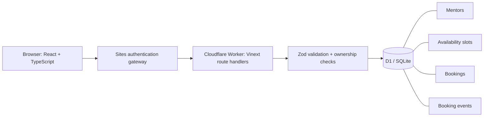

# Slotwise

[Live demo](https://slotwise-jash.artfulswan33.chatgpt.site) · [CI checks](https://github.com/jash2884/slotwise/actions/workflows/ci.yml)

A full-stack mentor scheduling application built with React, TypeScript, Vinext, Cloudflare Workers, and D1 (SQLite). Pick a mentor, book a 30-minute session, manage appointments, or publish your own availability.

## Implemented

- Search and filter mentors by specialty.
- Authenticated booking, profile management, and availability creation.
- Platform-backed sign-in with server-side authorization on every write.
- UTC timestamps rendered in the visitor's selected IANA timezone.
- Database-enforced protection against double-booking a slot or a learner's time.
- Idempotency keys: retries, including simultaneous retries, return the original booking.
- Cancellation by the learner or the owning mentor; canceled slots can be rebooked.
- Transactional booking audit events and retained cancellation history.
- Calendar file export, responsive layouts, keyboard-accessible dialogs, loading and error states.
- Explicit, repeatable sample-data loading. Sample mentors are fictional and clearly labeled.
- Type checking, reproducible local integration tests, and a GitHub Actions workflow.

## Run locally

Requires Node.js 24 and npm. No paid API keys are required.

```sh
npm ci
npm run typecheck
npm run build
node --import ./scripts/sites-env.mjs ./node_modules/wrangler/bin/wrangler.js d1 execute DB --local --config dist/server/wrangler.json --persist-to .wrangler/state --file drizzle/0000_steep_cyclops.sql
npm start -- --port 5173
```

Open the printed local URL. `npm run dev` is available for source development after local database setup.

Local preview does not emulate Sites sign-in. Public mentor discovery renders without identity. To exercise authenticated operations locally, the integration tests send development-only identity headers to localhost. **Do not expose the raw Wrangler preview to the internet**: production authentication depends on the Sites gateway supplying trusted identity. The hosted application uses `/signin-with-chatgpt` and never asks users to construct identity headers.

## Tests

```sh
npm run typecheck
npm run build
npm run test:integration
```

The integration runner creates an isolated local database, applies migrations, starts a built Worker on port 5174, exercises real HTTP endpoints, and stops its server. Port 5174 must be free. Test records stay in the isolated `.wrangler/test-*` directory and never reach production.

Coverage includes unauthenticated requests, foreign-origin writes, validation, ownership, privacy, 20 concurrent requests for one slot, cancellation and rebooking, learner time conflicts, sequential retries, 10 simultaneous retries, and repeatable sample data initialization. `npm run test:api` targets an already-running localhost server (default port 5173).

## Architecture



`app/page.tsx` contains the three workspace views. `app/api/` owns the HTTP interface. `lib/server.ts` centralizes request identity, origin checks, and errors. `db/schema.ts` defines the relational schema and partial unique indexes. Generated SQL is committed under `drizzle/`.

**Why the database constraint matters:** two requests can both observe an empty slot before either writes. An application-side availability check alone cannot prevent this race. A partial unique index on `slot_id WHERE status='confirmed'` lets the database arbitrate the winner. A second index on `(user_id, starts_at)` prevents a learner from booking different mentors at the same time. All slots are fixed 30-minute intervals on a UTC half-hour grid, so equal starts represent overlapping bookable intervals. Changing to arbitrary durations requires interval-overlap enforcement.

Booking creation and its audit event run in a transactional D1 batch. A booking request's UUID serves as its idempotency key. An existing key is returned only to the same user for the same slot. SQL values are bound parameters. Cancellations retain records so booking history is available.

## API

| Method | Path | Purpose |
|---|---|---|
| GET | `/api/state` | Mentor/slot discovery and the caller's permitted booking details |
| POST | `/api/profile` | Create or update the caller's mentor profile |
| POST | `/api/slots` | Add the caller's 30-minute availability |
| DELETE | `/api/slots` | Remove the caller's slot if it has no booking history |
| POST | `/api/bookings` | Book a future slot; optional UUID `Idempotency-Key` |
| PATCH | `/api/bookings` | Cancel a permitted future booking |
| POST | `/api/demo` | Explicitly initialize fictional sample mentors and slots |

Every user mutation requires identity. The sample-data endpoint additionally supports a temporary deployment-only `SLOTWISE_SEED_KEY` bearer secret for initializing public demo fixtures; this grants no booking or profile access and is removed after initialization. Anonymous discovery exposes public mentor fields and slot availability, never learner names or booking topics. A mentor can see sessions booked with them; a learner can see their own bookings.

## Deployment

The provided source is configured for Sites with the logical D1 binding `DB`. Sites provisions D1, applies the committed migrations, supplies authenticated identity, and deploys the built Worker. The `.openai/hosting.json` project identity belongs to this deployment. Remove its `project_id` before registering an independent fork; never reuse another owner's deployment identity.

The production code does not use a standalone Node/Express server or PostgreSQL. Vinext exposes Next-style route handlers on a Worker. Choosing D1 keeps the deployed runtime and database integrated without external credentials.

A Dockerfile is included for local runtime reproducibility; the Docker image itself has not been tested here. After building the image, apply migrations inside the container before starting it. The container does not supply hosted authentication and should be used locally only.

## Product boundaries

This is a working portfolio release. It does not send email reminders, process payments, create video calls, or sync with external calendar providers. Calendar export produces an `.ics` file; it is not two-way sync. Meeting links are arranged separately. The sample profiles are fictional; reserving their slots does not arrange real mentoring.

Discovery is bounded to 2,000 future slots and appointment history to 200 rows; this release does not implement pagination, booking quotas, abuse rate limits, or a cleanup job. Both learner and mentor can cancel a future booking. Previously booked slots are retained even after cancellation. A person who both hosts and learns can still create a conflict between these two roles; the learner index prevents overlapping learner bookings, while mentor availability is protected separately. Broader calendar conflict rules would be a follow-up feature.

For interview preparation, see [INTERVIEW_GUIDE.md](./INTERVIEW_GUIDE.md). Resume wording is in [RESUME_NOTES.md](./RESUME_NOTES.md).
